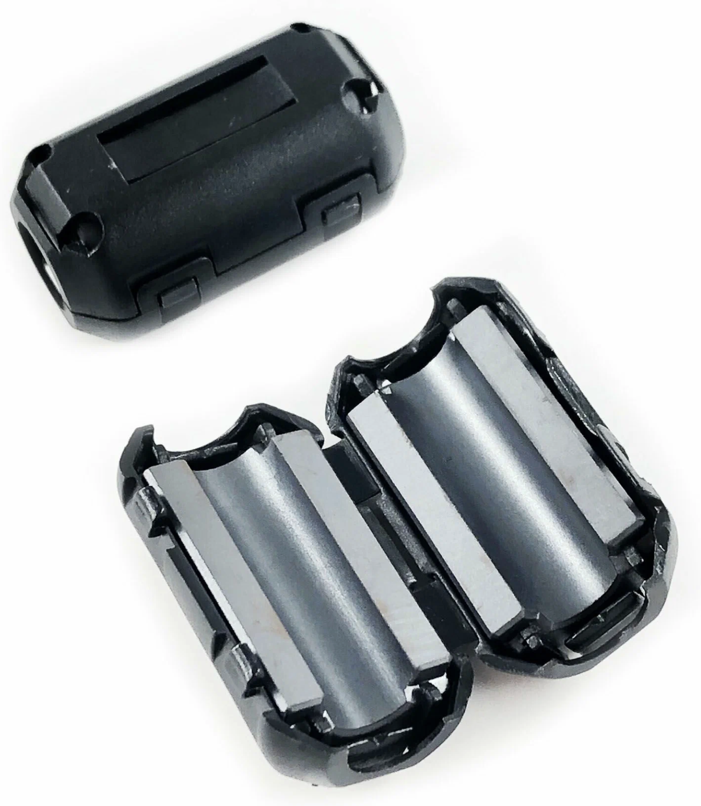
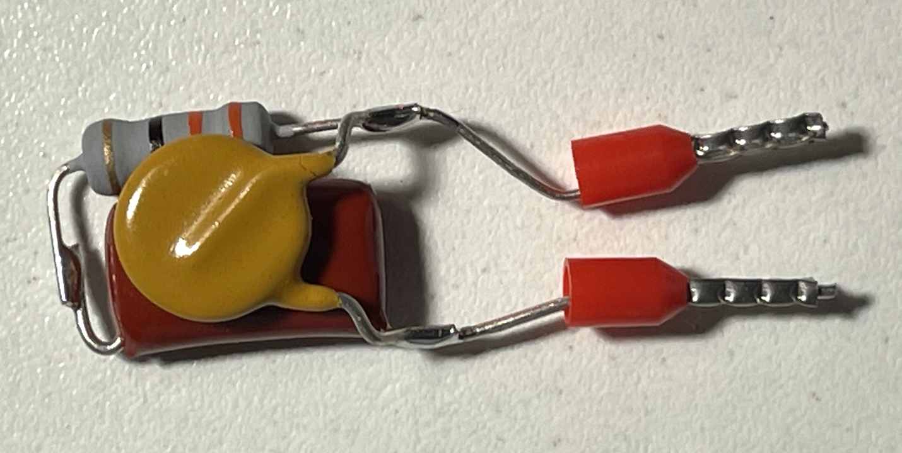
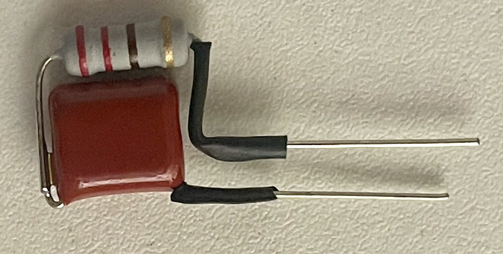
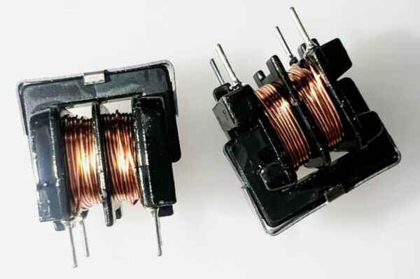
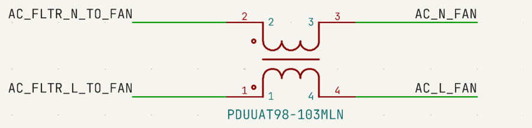

# Verbindungsprobleme mit iHeater und ihre Lösung

Bei der Verwendung von **iHeater** können in einigen Fällen Probleme mit der Verbindungsstabilität auftreten (Verbindungsabbrüche, „Verlust“ der MCU, instabiler Betrieb).  
In den meisten Fällen liegt dies nicht am Gerät selbst, sondern an externen Faktoren: Vibrationen, elektromagnetischen Einstreuungen oder Besonderheiten der Last.

Nachfolgend sind die wichtigsten Ursachen und Möglichkeiten zu ihrer Behebung aufgeführt.

---

## 1. Vibration des USB-Kabels

!!! warning "Symptome"
    - Periodische Verbindungsabbrüche  
    - Das Gerät „verschwindet“ aus dem System  
    - Die Verbindung wird beim Berühren des Kabels wiederhergestellt  

!!! info "Ursache"
    Vibrationen des Druckers können Mikrobewegungen des USB-Steckers verursachen, was zu einem kurzzeitigen Kontaktverlust führt.

!!! success "Lösung"
    - Fixieren Sie das USB-Kabel fest im Anschluss  
    - Vermeiden Sie Zugbelastung am Kabel  
    - Falls erforderlich:
        - verwenden Sie ein Kabel mit festerem Sitz  
        - fixieren Sie das Kabel mit Heißkleber / Kabelbinder / Halter  

---

## 2. Einstreuungen durch Stromleitungen

!!! warning "Symptome"
    - Verbindungsverlust beim Einschalten der Heizung oder des Lüfters  
    - Zufällige Neustarts des Geräts  
    - Instabiler Betrieb ohne offensichtlichen Grund  

!!! info "Ursache"
    Wechselstrom-Versorgungsleitungen erzeugen elektromagnetische Störungen, die in das USB-Kabel einkoppeln.

 

!!! success "Lösung"
    - Verlegen Sie USB-Kabel und Stromleitungen so weit wie möglich voneinander entfernt  
    - Verlegen Sie sie nicht im selben Kabelkanal  
    - Vermeiden Sie parallele Verlegung über längere Strecken  
    - Installieren Sie einen Ferritfilter (Ferritzylinder) am USB-Kabel näher am Controller und/oder an der Druckerplatine

---

## 3. Störungen durch den Lüfter

!!! warning "Symptome"
    - Verbindungsverlust beim Ein- oder Ausschalten des Lüfters  
    - Störungen, die mit dem Betrieb des Lüfters zusammenfallen  
    - Instabilität bei PWM-Steuerung  

!!! info "Ursache"
    Der 110-220-V-Lüfter ist mit einem Schaltnetzteil ausgestattet und kann Störungen erzeugen, die denen jedes Schaltnetzteils ähneln.
    Diese Störungen können Signalleitungen beeinflussen.

!!! success "Lösung"
    Es wird empfohlen, einen **RC-Snubber (snubber)** parallel zum Lüfter zu installieren. Oder einen Ferritfilter zu verwenden

### Stromkompensierte Drossel

!!! danger "Netzspannung"
    Die Drossel wird in den 110–230-V-Kreis eingebunden. Führen Sie die Montage nur bei vom Netz getrenntem Gerät durch.

Eine stromkompensierte Drossel (Common Mode Choke) ist eine der wirksamsten erprobten Methoden, Störungen aus dem Netzteil des Lüfters zu unterdrücken. Sie unterdrückt Gleichtaktstörungen auf den Leitungen L und N und beeinflusst die Versorgung des Lüfters nicht.

Schalten Sie die Drossel in die Versorgungsleitungen des Lüfters:

1. Führen Sie die Leitung L durch die Wicklung 1–4 und die Leitung N durch die Wicklung 2–3.
2. Schließen Sie die Pins 1 und 2 (mit Punkt markiert) an die Klemme FAN der iHeater-Platine an, die Pins 4 und 3 an den Lüfter.

Im Schaltplan ist die Drossel `PDUUAT98-103MLN` dargestellt.

---

## 4. USB-3.0-Port - Probleme im Betrieb

!!! warning "Symptome"
    - Periodische Verbindungsabbrüche während des Betriebs  
    - Das Gerät „verschwindet“ ohne ersichtlichen Grund aus dem System  
    - Das Problem verschwindet beim Wechsel auf einen anderen Port  

!!! info "Ursache"
    Dies ist ein verbreitetes Problem von USB-Geräten, die im Full-Speed-Modus (USB 2.0) arbeiten, wenn sie an USB-3.0-Ports angeschlossen werden. In modernen Computern verwenden USB-3.0-Ports eUSB2-Repeater, die nicht vollständig mit der USB-2.0-Spezifikation kompatibel sind - dies führt zu Synchronisationsfehlern und Fehlern bei der Geräteerkennung. Das Problem wurde von STMicroelectronics offiziell bestätigt: [FAQ auf der ST-Website](https://community.st.com/t5/stm32-mcus/faq-possible-communication-failure-between-stlink-v3-and-some/ta-p/736578).

!!! success "Lösung"
    - Schließen Sie iHeater **nur an USB-2.0-Ports** an (normalerweise schwarze Anschlüsse)  
    - Wenn alle Ports USB 3.0 sind, verwenden Sie einen **aktiven USB-Hub mit USB-2.0-Ports**

---

## 5. USB-3.0-Port - Probleme beim Flashen

!!! warning "Symptome"
    - Der Controller wird im DFU-Modus nicht erkannt  
    - Das Flashen endet mit einem Fehler oder hängt sich auf  
    - `dfu-util` erkennt das Gerät nicht oder bricht den Schreibvorgang ab  

!!! info "Ursache"
    Dasselbe Kompatibilitätsproblem USB 3.0 / xHCI. Besonders relevant beim Flashen über USB-Type-C-Ports an modernen Laptops - diese verwenden häufiger problematische eUSB2-Repeater.

!!! success "Lösung"
    - Schließen Sie den Controller beim Flashen **nur an einen USB-2.0-Port** an  
    - Bevorzugen Sie USB-Type-A-Ports auf der Rückseite des PCs  
    - Wenn das Problem weiterhin besteht, verwenden Sie einen **aktiven USB-Hub mit USB-2.0-Ports**

    
