# BOM (Bill of Materials)

List of components for assembling one iHeater: electronics, sensors, fasteners, and consumables. Links point to the items to order. Printed parts are listed in [CAD](cad.md).

| | Name | Link | Quantity |
|---|---|---|---|
|  | PTC Ceramic Air Heater 220V\|110V (1 of the 3 heating elements is required) | [link](https://aliexpress.ru/item/1476109411.html) | 1 |
| 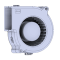 | Ec7530 Turbine Blower Double Ball Bearing 220V\|110V | [link](https://www.aliexpress.com/item/1005003429103124.html) | 1 |
| 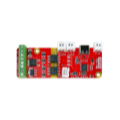 | PCB iHeater |  | 1 |
| 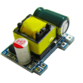 | AC-DC Power Module AC 50–270V / DC 5V 700mA |  | 1 |
| 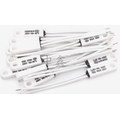 | KSD9700 5A 250V 135C Normal Close | [link](https://www.aliexpress.com/item/32959243565.html) | 1 |
| 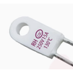 | RH 135C | [link](https://www.aliexpress.com/item/1005001892569431.html) | 1 |
| 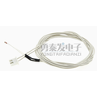 | 100K NTC3950 100CM xh2.54 | [link](https://www.aliexpress.com/item/1005008996648273.html) | 1 |
|  | 100K NTC3950 10CM xh2.54 |  | 1 |
| 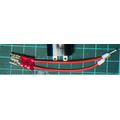 | Silicone Cable 1m 20AWG | [link](https://www.aliexpress.com/item/1005008409314314.html) | 1m |
|  | E0508 Tube insulating Insulated terminals | [link](https://www.aliexpress.com/item/32814805492.html) | 8 |
| 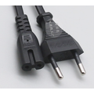 | US EU to C7 Cable | [link](https://www.aliexpress.com/item/1005001299125752.html) | 1 |
| 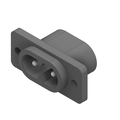 | Male Power Socket C7 AC-005 | [link](https://www.aliexpress.com/item/1005010412204145.html) | 1 |
| 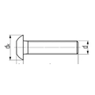 | M3\*6 ISO7380 |  | 8 |
| 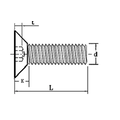 | M3\*6 din7991 |  | 6 |

!!! note "Thermal Protector"
    Use the KSD9700 during assembly and testing. For permanent operation, replace it with the RH 135C. See [Safety](safety.md) for details.
