# Lista de materiales (BOM)

Lista de componentes para montar un iHeater: electrónica, sensores, tornillería y consumibles. Los enlaces apuntan a los artículos para realizar el pedido. Las piezas impresas se encuentran en [CAD](cad.md).

| | Name | Link | Quantity |
|---|---|---|---|
| 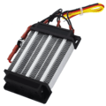 | PTC Ceramic Air Heater 220V\|110V (se necesita 1 de los 3 elementos calefactores) | [enlace](https://aliexpress.ru/item/1476109411.html) | 1 |
| 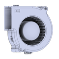 | Ec7530 Turbine Blower Double Ball Bearing 220V\|110V | [enlace](https://www.aliexpress.com/item/1005003429103124.html) | 1 |
| 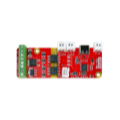 | PCB iHeater |  | 1 |
| 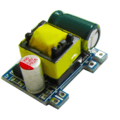 | AC-DC Power Module AC 50–270V / DC 5V 700mA |  | 1 |
| 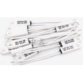 | KSD9700 5A 250V 135C Normal Close | [enlace](https://www.aliexpress.com/item/32959243565.html) | 1 |
| 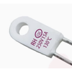 | RH 135C | [enlace](https://www.aliexpress.com/item/1005001892569431.html) | 1 |
| 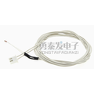 | 100K NTC3950 100CM xh2.54 | [enlace](https://www.aliexpress.com/item/1005008996648273.html) | 1 |
|  | 100K NTC3950 10CM xh2.54 |  | 1 |
| 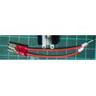 | Silicone Cable 1m 20AWG | [enlace](https://www.aliexpress.com/item/1005008409314314.html) | 1m |
|  | E0508 Tube insulating Insulated terminals | [enlace](https://www.aliexpress.com/item/32814805492.html) | 8 |
| 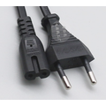 | US EU to C7 Cable | [enlace](https://www.aliexpress.com/item/1005001299125752.html) | 1 |
| 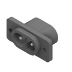 | Male Power Socket C7 AC-005 | [enlace](https://www.aliexpress.com/item/1005010412204145.html) | 1 |
| 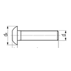 | M3\*6 ISO7380 |  | 8 |
| 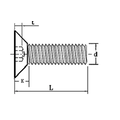 | M3\*6 din7991 |  | 6 |

!!! note "Thermal Protector"
    Use el KSD9700 durante el montaje y las pruebas. Para el uso permanente, sustitúyalo por el RH 135C. Más información en [Seguridad](safety.md).
