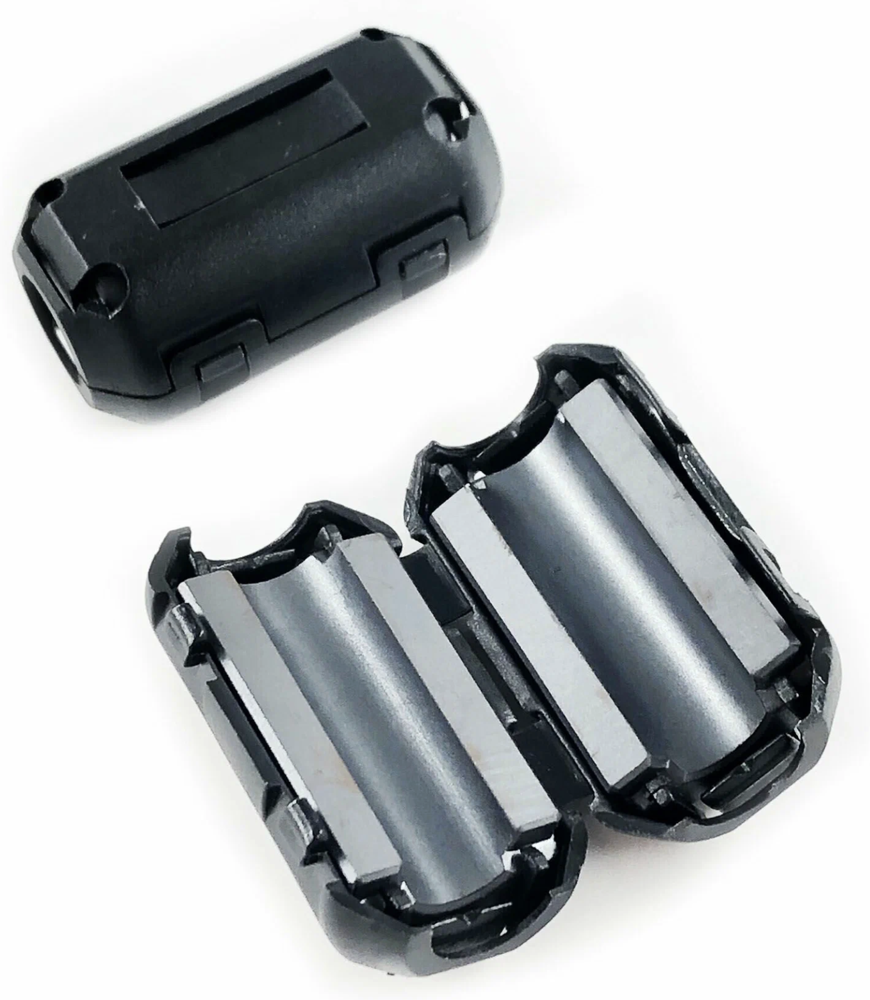
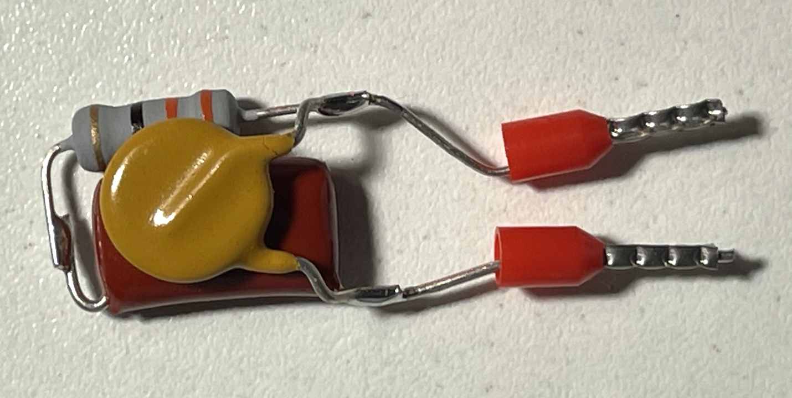
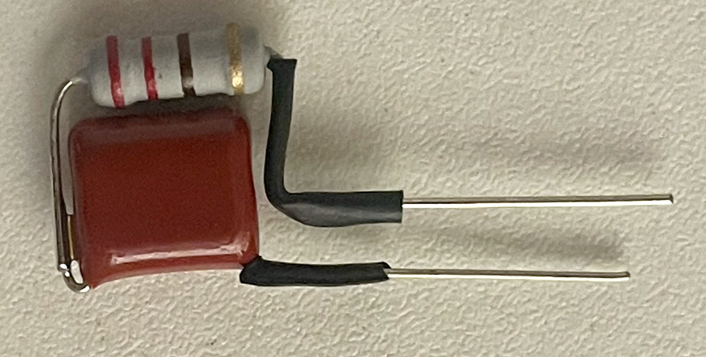
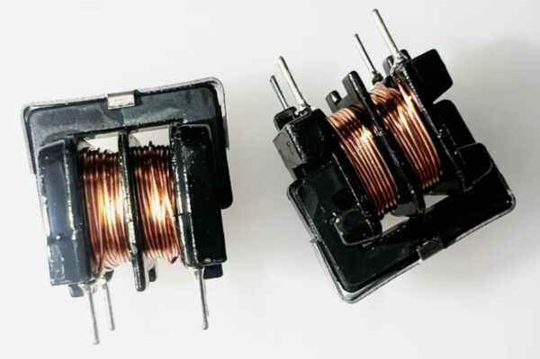
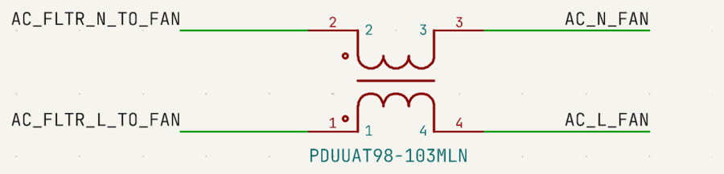

# Problèmes de communication avec iHeater et solutions

Lors de l'utilisation de **iHeater**, des problèmes de stabilité de connexion peuvent parfois survenir (déconnexions, MCU « perdu », fonctionnement instable).  
Dans la plupart des cas, ils ne sont pas liés à l'appareil lui-même, mais à des facteurs externes : vibrations, interférences électromagnétiques ou particularités de la charge.

Vous trouverez ci-dessous les causes principales et les méthodes pour les éliminer.

---

## 1. Vibration du câble USB

!!! warning "Symptômes"
    - Déconnexions périodiques  
    - L'appareil « disparaît » du système  
    - La connexion se rétablit lorsque l'on touche le câble  

!!! info "Cause"
    Les vibrations de l'imprimante peuvent provoquer des micro-mouvements du connecteur USB, ce qui entraîne une brève perte de contact.

!!! success "Solution"
    - Fixez fermement le câble USB dans le connecteur  
    - Supprimez toute tension sur le câble  
    - Si nécessaire :
        - utilisez un câble avec un ajustement plus serré  
        - fixez le câble avec de la colle thermofusible / un collier / un support  

---

## 2. Interférences provenant des câbles de puissance

!!! warning "Symptômes"
    - Perte de connexion lors de l'activation du chauffage ou du ventilateur  
    - Redémarrages aléatoires de l'appareil  
    - Fonctionnement instable sans cause évidente  

!!! info "Cause"
    Les câbles d'alimentation en courant alternatif génèrent des interférences électromagnétiques qui sont induites dans le câble USB.

 

!!! success "Solution"
    - Éloignez autant que possible le câble USB des câbles de puissance  
    - Ne les faites pas passer dans le même chemin de câble  
    - Évitez les parcours parallèles sur de longues sections  
    - Installez un filtre ferrite (cylindre ferrite) sur le câble USB, près du contrôleur et/ou de la carte de l'imprimante

---

## 3. Interférences provenant du ventilateur

!!! warning "Symptômes"
    - Perte de connexion lors de l'activation/désactivation du ventilateur  
    - Pannes coïncidant avec le fonctionnement du ventilateur  
    - Instabilité avec le contrôle PWM  

!!! info "Cause"
    Le ventilateur 110-220 V est équipé d'une alimentation à découpage ; il peut générer des interférences similaires à celles de toute alimentation à découpage.
    Ces interférences peuvent affecter les lignes de signal.

!!! success "Solution"
    Il est recommandé d'installer un **RC snubber (snubber)** en parallèle avec le ventilateur. Ou d'utiliser un filtre ferrite

### Self de mode commun

!!! danger "Tension secteur"
    La self est raccordée au circuit 110–230 V. Effectuez le montage uniquement appareil hors tension.

La self de mode commun (common mode choke) est l'un des moyens éprouvés les plus efficaces pour supprimer les perturbations de l'alimentation du ventilateur. Elle atténue le bruit de mode commun sur les lignes L et N et n'affecte pas l'alimentation du ventilateur.

Insérez la self en série dans l'alimentation du ventilateur :

1. Faites passer la ligne L par l'enroulement 1–4 et la ligne N par l'enroulement 2–3.
2. Raccordez les broches 1 et 2 (repérées par un point) à la borne FAN de la carte iHeater, et les broches 4 et 3 au ventilateur.

Le schéma montre la self `PDUUAT98-103MLN`.

---

## 4. Port USB 3.0 — problèmes en fonctionnement

!!! warning "Symptômes"
    - Déconnexions périodiques pendant le fonctionnement  
    - L'appareil « disparaît » du système sans raison visible  
    - Le problème disparaît après le passage à un autre port  

!!! info "Cause"
    Il s'agit d'un problème courant des appareils USB fonctionnant en mode Full Speed (USB 2.0) lorsqu'ils sont connectés à des ports USB 3.0. Sur les ordinateurs modernes, les ports USB 3.0 utilisent des répéteurs eUSB2 qui ne sont pas entièrement compatibles avec la spécification USB 2.0 — cela entraîne des erreurs de synchronisation et d'énumération de l'appareil. Le problème est officiellement confirmé par STMicroelectronics : [FAQ sur le site ST](https://community.st.com/t5/stm32-mcus/faq-possible-communication-failure-between-stlink-v3-and-some/ta-p/736578).

!!! success "Solution"
    - Connectez iHeater **uniquement aux ports USB 2.0** (généralement les connecteurs noirs)  
    - Si tous les ports sont USB 3.0, utilisez un **hub USB actif avec des ports USB 2.0**

---

## 5. Port USB 3.0 — problèmes lors du flashage

!!! warning "Symptômes"
    - Le contrôleur n'est pas détecté en mode DFU  
    - Le flashage se termine par une erreur ou se bloque  
    - `dfu-util` ne voit pas l'appareil ou interrompt l'écriture  

!!! info "Cause"
    Le même problème de compatibilité USB 3.0 / xHCI. Il est particulièrement pertinent lors du flashage via les ports USB Type-C sur les ordinateurs portables modernes : ils utilisent plus souvent des répéteurs eUSB2 problématiques.

!!! success "Solution"
    - Lors du flashage, connectez le contrôleur **uniquement à un port USB 2.0**  
    - Privilégiez les ports USB Type-A à l'arrière du PC  
    - Si le problème persiste, utilisez un **hub USB actif avec des ports USB 2.0**

    
